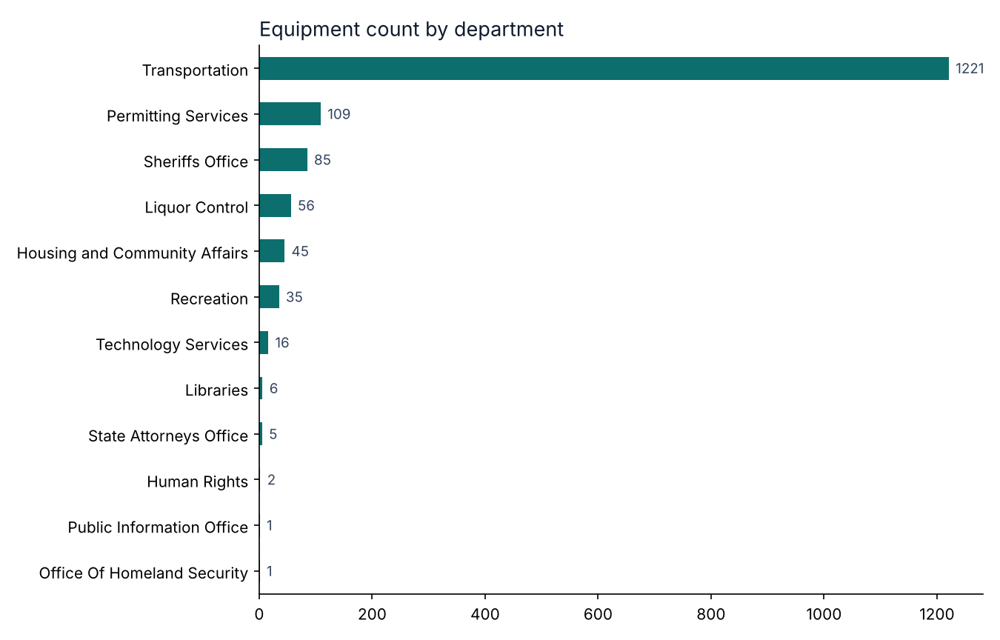
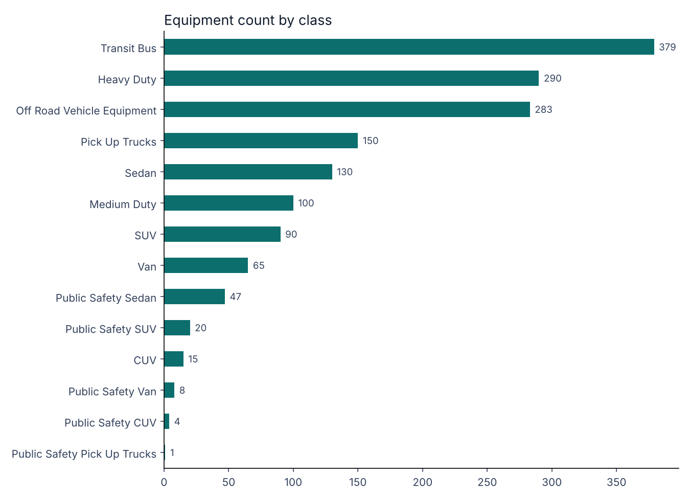

# Fleet Inventory Data Analysis (Excel)

Final project for the **IBM Data Analyst Professional Certificate** (Coursera), course *Excel for Data Analysis: Essential Skills & Techniques*.

## Scenario

As a junior data analyst in a local government office, I worked with a real-world fleet equipment inventory for Montgomery. The project had two parts: cleaning a raw extract of the inventory, then analyzing a prepared inventory with pivot tables in Excel for the web.

## Part 1: Data cleaning

Workbook: [`data/part1_raw_data_for_cleaning.xlsx`](data/part1_raw_data_for_cleaning.xlsx)

The raw extract had several data quality problems to fix:

| Problem | Example in the raw data |
|---|---|
| Department name split across two columns | `Fire and` / `Rescue` |
| Blank rows between records | 5 empty rows |
| Duplicate records | `Fire and Rescue, Public Safety CUV, 4` listed twice |
| Misspellings | `Rehabilltation`, `Recsue`, `Servcies`, `Enviromnental` |
| Inconsistent spacing | `Pick Up  Trucks`, `Off Road VehicleEquipment` |

## Part 2: Analysis with pivot tables

Workbook: [`data/part2_pivot_table_analysis.xlsx`](data/part2_pivot_table_analysis.xlsx)

The inventory covers **1,582 pieces of equipment** across **12 departments** and **14 equipment classes**. I built three pivot tables, each on its own worksheet:

| Worksheet | What it shows |
|---|---|
| `Equipment by Department` | Total equipment per department, sorted from largest to smallest |
| `Department by Class` | Each department broken down by equipment class |
| `Class by Department` | Each equipment class broken down by department |

### Findings

- **Transportation** holds most of the fleet: 1,221 units, about 77% of the total. Its largest groups are transit buses (379), off-road vehicle equipment (276), and heavy-duty vehicles (248).
- **Permitting Services** (109 units) and the **Sheriff's Office** (85 units) come next. The Sheriff's Office runs most of the public safety vehicles.
- Across all departments, the most common classes are transit buses (379), heavy-duty vehicles (290), and off-road vehicle equipment (283).

## Tools

Excel for the web: data cleaning, sorting and filtering, pivot tables.
The charts in this README were generated from the pivot table data.

## Author

**Fritz Arnold Meno Njikam**, Data Analyst
[Portfolio](https://arnoldnjikam3173.github.io/arnold.njikam/) · [LinkedIn](https://www.linkedin.com/in/meno-njikam-arnold)
